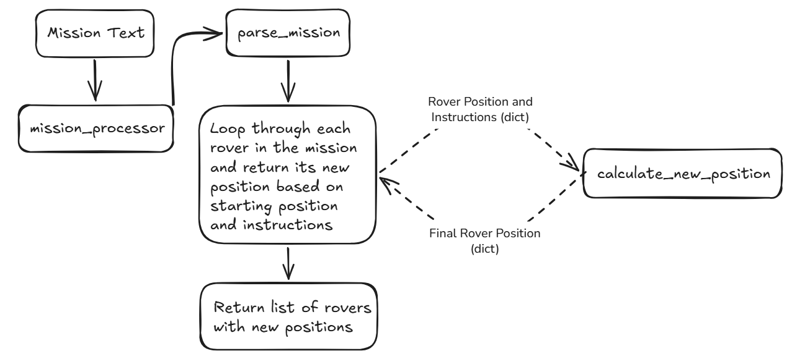

# Project Notes

## Logic Layer

The logic layer processes mission data as formatted by the input layer and consisting of:

- Mission Plateau size
- Rover Data:
    - Starting Postion
    - Instructions

The data is formatted like this:

```python
{
    "plateau": {"max_x": 5, "max_y": 5},
    "rovers": [
        {
            "position": {"x": 1, "y": 2, "direction": "N"},
            "instructions": ["L", "M", "L", "M", "L", "M", "L", "M", "M"],
        },
        {
            "position": {"x": 3, "y": 3, "direction": "E"},
            "instructions": ["M", "M", "R", "M", "M", "R", "M", "R", "R", "M"],
        },
    ],
}
```

### Processing Movement Instructions

To process instructions, a lookup table will be created as a constant to help determine:
- What direction a rover faces once it has been rotated by and `L` or `R` instruction
- How to modify the rover's position when it moves due to an `M` instruction

The change to the rover's position is dependent on the direction it is facing:

|Rover's Direction|Change When Moved in this direction|
|---|---|
|North|`y + 1`|
|East|`x + 1`|
|South|`y - 1`|
|West|`x - 1`|

### Orchestration of Mission Processing

`main.py` will handle the orchestration of the mission processing logic by accepting a mission text with starting positions and processing each rover in turn as shown in the below diagram:



### `execute_instructions()` Exception Handling

The below custom exceptions have been created to help with orchestrating mission processing:

`InvalidInstructionError`: Raised when a malformed instructions string is passed to the `parse_instructions()` function.

`InvalidPlateauError`: Raised when a malformed plateau dimensions string is passed to the `parse_plateau()` function.

`InvalidPositionError`: Raised when a malformed position string is passed to the `parse_position()` function.

The above cover the most likely errors that are likely to occur when a mission is processed.

All of the above inherit from the `MissionError` exception which inherits from `Exception`.

> NOTE:- If any of the above exceptions is raised during the mission processing function (`execute_mission()`) the function will abort processing the mission and print an error message to the terminal.
